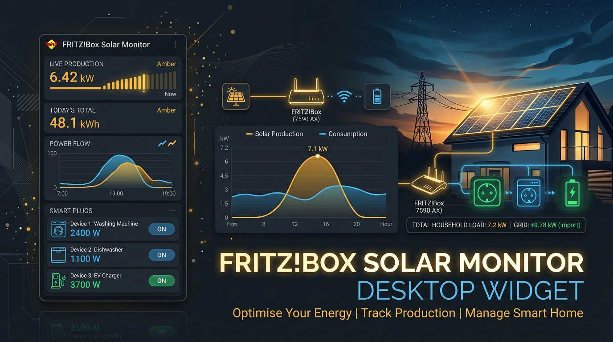

<div align="center">



# ☀️ FRITZ!Box Solar Monitor Desktop Widget

**Ein leichtgewichtiges, modernes Windows-Desktop-Widget zur Echtzeit-Überwachung von Solaranlagen & Balkonkraftwerken an AVM FRITZ!Box Steckdosen (FRITZ!DECT 200 / 210 & FRITZ!Smart Energy 210).**

[](https://python.org)
[](https://microsoft.com/windows)
[](https://developer.microsoft.com/microsoft-edge/webview2/)
[](https://avm.de)
[](LICENSE)

</div>

---

## 📌 Übersicht

Wenn Balkonkraftwerke oder Solarmodule ihren Strom über **FRITZ!DECT 200 / 210** oder **FRITZ!Smart Energy 210** Steckdosen ins Hausnetz einspeisen, misst die FRITZ!Box die erzeugte Wirkleistung und die Gesamterträge kontinuierlich mit. 

Der **FRITZ!Box Solar Monitor** bringt diese Messwerte direkt als unaufdringliches, fest platziertes Desktop-Widget in die obere rechte Ecke deines Windows-Bildschirms – ohne störende Konsolenfenster, ohne erzwungenen Vordergrund und mit einem Klick aufklappbarem Live-Ertragsgraphen.

---

## ✨ Features

* **⚡ Echtzeit-Einspeisung der 3 Steckdosen:**
  * Separate Kacheln für jeden Einspeisepunkt mit aktuellem Watt-Wert (z. B. *Garage Süd*, *Garage Ost*, *Schuppen*).
  * Prominent hervorgehobene **Gesamteinspeisung** aller 3 Solardosen in Watt.
* **📈 Interaktiver Live- & Tagesverlauf (auf Klick):**
  * Klick auf das Kurvensymbol klappt das Diagramm flüssig nach unten aus.
  * Farbcodierte Kurven (Gesamtleistung sowie die 3 Steckdosen getrennt) und Anzeige des heutigen Spitzenwerts (Peak).
* **🔋 Präzise Tagessumme (kWh):**
  * Zählt die heute erzeugten Kilowattstunden hoch.
  * Nutzt die internen Zählerstände der FRITZ!Box, sodass die Werte auch dann exakt stimmen, wenn der PC erst nachmittags eingeschaltet wird.
* **📅 Jahressumme & Gesamtertrag:**
  * Berechnet die Erzeugung der letzten 12 Monate direkt aus den internen Monats-Statistiken der FRITZ!Box.
  * Zeigt zusätzlich den kumulierten Zählerstand seit Installation an.
* **🪟 Echtes Windows-Widget-Feeling (unsichtbar, dass es Python ist):**
  * Kein schwarzes CMD- oder Terminalfenster im Hintergrund (`pythonw.exe`).
  * Moderne, hochauflösende Oberfläche über Microsofts Windows-integriertes WebView2.
  * **Feste Position oben rechts:** Erkennt automatisch Monitorauflösung und Taskleiste.
  * **Ruckelfreies Bewegen:** Nutzt native Windows-Kernel-Nachrichten (`WM_NCLBUTTONDOWN`) – kein Springen bei Monitoren mit 125%, 150% oder 175% DPI-Skalierung.
* **🔒 Sichere Authentifizierung:**
  * Unterstützt das moderne PBKDF2-Sicherheitsverfahren (FRITZ!OS 7.24+ / 7.50+ / 8.0+) sowie legacy MD5.
  * Automatische Erkennung des Standard-Benutzers: Du musst in der Regel **nur dein FRITZ!Box-Kennwort** eingeben.

---

## 🚀 Schnellstart

### 1. Repository klonen oder herunterladen
```bash
git clone https://github.com/tnickel/FritzBoxMonitor.git
cd FritzBoxMonitor
```

### 2. Abhängigkeiten installieren
Das Projekt nutzt eine lokale virtuelle Umgebung (`.venv`):

Mit [uv](https://github.com/astral-sh/uv) (empfohlen, extrem schnell):
```bash
uv venv .venv
uv pip install -r requirements.txt
```
Oder mit Standard-Python:
```bash
python -m venv .venv
.venv\Scripts\pip install -r requirements.txt
```

### 3. Widget starten
Einfach die Datei **`start.bat`** per Doppelklick ausführen!
Das Widget startet lautlos im Hintergrund und positioniert sich oben rechts auf deinem Monitor.

> **Tipp für Windows Autostart:**  
> Lege eine Verknüpfung zu `start_silent.vbs` in deinen Windows-Autostart-Ordner (`Win + R` → `shell:startup`). Dadurch startet das Solar-Widget beim Einschalten des PCs ohne jegliches Konsolen-Flackern.

---

## ⚙️ Einstellungen (Zahnrad-Symbol)

Über das Zahnrad-Symbol (⚙️) oben rechts im Widget öffnest du den Einstellungsdialog:

1. **FRITZ!Box Adresse:** Standardmäßig `192.168.178.1` (oder `fritz.box`).
2. **FRITZ!Box Kennwort:** Dein Kennwort für die FRITZ!Box-Oberfläche.
3. **Aktualisierungsintervall:** Frei wählbar zwischen 30 Sekunden, 1 Minute (Standard), 2 Minuten oder 5 Minuten.
4. **Steckdosen-Zuweisung:** Klicke auf *„Steckdosen suchen“*, um alle an deiner FRITZ!Box angemeldeten Smart-Home-Energiesteckdosen abzurufen und die 3 Solardosen zuzuweisen.

---

## 🛠️ Technische Details & Schnittstellen

* **AHA-HTTP-Interface:** Kommunikation über die offizielle AVM Home Automation HTTP-Schnittstelle (`/webservices/homeautoswitch.lua`).
* **Messwerte:**
  * `<power>`: Wirkleistung in Milliwatt (mW) $\rightarrow$ Umrechnung in Watt ($W$).
  * `<energy>`: Zählerstand in Wattstunden (Wh) $\rightarrow$ Umrechnung in Kilowattstunden ($kWh$).
  * `getbasicdevicestats`: Abruf der 24h-Verläufe und Monatsstatistiken aus dem internen Ringspeicher der FRITZ!Box.
* **Datenschutz & Lokale Speicherung:**
  * Das FRITZ!Box-Kennwort und die Messdaten werden ausschließlich lokal auf deinem Rechner in `data/config.json` bzw. `data/energy_baselines.json` gespeichert.
  * Die `.gitignore` stellt sicher, dass keinerlei Passwörter oder persönliche Messstände in Git oder auf GitHub landen.

---

## 📄 Lizenz

Dieses Projekt ist unter der [MIT Lizenz](LICENSE) veröffentlicht.
